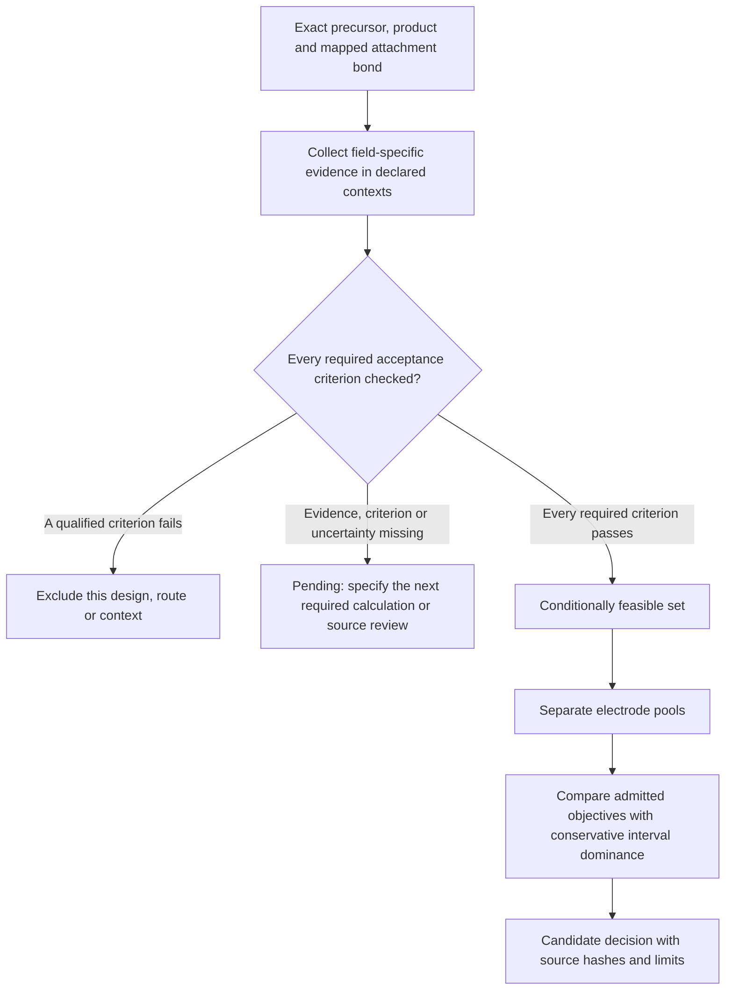

# Candidate admission requires every required axis

A candidate needs acceptable performance on every required axis in its declared
operating context. A strong potential, nominal capacity or molecular descriptor
rank cannot compensate for a failed attachment route or excessive unwanted
interaction. Missing information remains pending and is not an inferred pass or
a chemical rejection.

The current policy is [candidate_feasibility.json](../config/candidate_feasibility.json).
It describes a conditional computational shortlist. It does not establish
experimental bead performance. Several application targets remain deliberately
unset; they must be justified before a complete shortlist can be published.



## Required dimensions

| Axis | Evidence needed | Inadequate substitute |
| --- | --- | --- |
| Redox window | Exact graft-state path, reference, physical QC and justified uncertainty/sensitivity in the operating medium | A parent potential or an uncalibrated sigma treated as a prediction interval |
| Capacity | Accessible electron path and a stated polymer/loading/counterion mass convention | Nominal capacity of the capped molecule presented as bead capacity |
| State stability | Declared state integrity and appropriate chemical-stability checks | Disproportionation energy or SCF convergence alone |
| Intended charge transfer | A qualified solution-state model and a stated kinetic criterion | A gas-only reorganization diagnostic used as a rate |
| Attachment route | Precursor access, selectivity, conditions, balance, redox retention and exact bond-bound source assessment | SA score or a family analogue promoted to an exact-route demonstration |
| Grafting thermodynamics | The specified base/byproducts, standard states, temperature and adequate method/conformer sensitivity | A positive HCl reference used to reject a different base-assisted route |
| Unwanted association | A defined motif interaction quantity with appropriate fragment/deformation/backbone separation and ensemble scope | Stacking distance or full-segment association relabeled as motif binding |
| Unwanted intersite coupling | Coupling for the relevant charge states, geometries and environment | Neutral contact geometry or association energy converted into an ET rate |
| Occupancy sensitivity | Matched loading/spacing and backbone-configuration scenarios with adequate conformer treatment | A dense short oligomer presented as the actual graft distribution |
| Accessibility | A stated support/linker/medium accessibility model and acceptance criterion | Molecular solubility, SA or graft count alone |

Operating properties must share a declared operating context. Route evidence and
reaction thermodynamics share a separate reaction context: synthesis solvent and
temperature may differ from battery operation, but mismatched route/G records
cannot be silently joined. Incompatible product identity, model scope, units,
policy version or context is an input error.

For a numeric criterion, the entire accepted uncertainty/sensitivity interval
must meet the bound to pass. An interval wholly outside the bound fails; one
crossing a boundary remains pending. A qualified scenario envelope remains a
conditional model sensitivity, not a universal experimental confidence interval.
The current model redox window and a nonpositive defined-route G screen are
explicit conventions. Material-capacity, intended-ET, motif-association and
intersite-coupling targets remain unset; choosing them from ranks to obtain
winners would be circular.

## Pareto comparison after admission

The successor `redox.screening.pareto.decision_front` uses the same qualified
axis records that passed admission. It does not reuse molecular nominal capacity
as a material-capacity objective. Anolytes and catholytes remain separate. Signed
coupling/interaction quantities can be compared by magnitude when that is the
declared objective, avoiding a phase-sign preference. No weighted aggregate
score is calculated.

Dominance is conservative: the least favorable bound of one candidate must be
at least as good as the most favorable bound of the other on every objective,
and strictly better on one. Overlapping intervals cannot manufacture a confident
preference. This implementation is intended for the qualified comparison set;
it is not a demonstrated million-molecule frontier benchmark. The stateless
per-candidate admission function is independent across cases and can be used in
the existing chunked execution framework.

The historical four-objective molecular scorecard and partial descriptor plots
remain reproducible. They are not the new all-axis decision shortlist.

## Current evidence and reproduction

[The current decision ledger](../results/selection/current.json) records the
published candidate feed's own date. It joins 837 enumerated designs with the
75-candidate evaluation cohort and one comparison control, producing 879 distinct
graphs after overlap. The present ledger has 878 pending candidate designs and
one comparison control, with no full-axis eligible candidate. This primarily
reflects missing criteria/evidence, not 878 demonstrated chemical failures.

```bash
export PYTHONPATH="$PWD/src"
export OMP_NUM_THREADS=1 OMP_THREAD_LIMIT=1 MKL_NUM_THREADS=1
export OPENBLAS_NUM_THREADS=1 NUMEXPR_NUM_THREADS=1 XTB_THREADS=1
python scripts/pipeline/collect_candidate_decisions.py --out NEW_RESULT_DIRECTORY
python scripts/plotting/candidates/plot_descriptor_pareto.py --decisions NEW_RESULT_DIRECTORY
python scripts/plotting/candidates/plot_candidate_axis_matrix.py --decisions NEW_RESULT_DIRECTORY
```

Each collection refuses an existing output directory, snapshots its inputs and
producer sources, checks source stability, and retains every pending/excluded
case. Optional `--axis-receipts` must match exact graph, scope, units and policy;
all referenced backing hashes are checked. Receipt changes never silently fill
an uncomputed field.

The normal publication entry point is `scripts/pipeline/publish_candidate_decisions.py`.
It is called by `finalize_after_dft.sh` and `update_candidate_overlays.py`, so the
rule is part of delivery rather than an optional interpretation of a scatter
plot. Lower-level snapshot reproduction remains available through the commands
above. Source-current admission and successful result publication precede the
stable current-pointer update.
