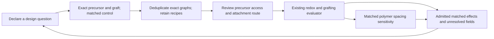

# Candidate expansion and evaluation as one loop

Use the [integrated report](../results/discovery/expansion/index.html) to see why
designs exist, their declared controls, their current evaluation and the next
unresolved question. The [design plan](../config/candidate_expansion_plan.json)
defines the axes and source inputs. This is a downstream consumer of the existing
evaluator, not an alternative property model or ranking system.



## What is connected

The join uses canonical isomeric SMILES and checks the declared InChIKey. Aliases
and symmetry-equivalent recipes remain attached to one exact graph. Conflicting
IDs, ambiguous duplicate evaluations and graft-energy records for another product
are rejected. Counterions are never silently discarded to obtain a graph match.

| Input | Role in the integrated view |
| --- | --- |
| Frozen 837-design family pool | Declared core × cap × anchor × ring coverage, all generation recipes |
| Existing candidate feed | Admitted exact-graft redox fields, model limitations and missing quantities |
| Declared comparison controls | Same charge/electron events; candidate-minus-control effects |
| Existing prospective route gate | Candidate-specific precursor, selectivity, conditions and core-retention requirements |
| Reference and base-assisted grafting outputs | Separate defined reactions, with exact product identity checks |
| Checked polymer-model outputs | Context for the same attachment fragment; distinct molecular environments |
| Current spacing campaign | Progress context; no transfer of pending quantities into candidate properties |

The initial collection joins **879 distinct graphs**: 837 enumerated designs with
75 current candidates and one external comparison control. The sets overlap;
adding their sizes would count some graphs twice. It contains 26 declared matched
comparisons. These counts belong to this frozen feed; use the current report's
source date and status when refreshing.

The ledger stage `proposed_only` means that a pool design has no entry in this
published evaluation feed. It is not a filesystem-wide assertion that the graph
has never been registered or calculated elsewhere. Such entries receive no
properties until they appear in an admitted evaluator output.

The enumerator covers viologen, PMDI and NDI. BQ/AQ enumeration and explicit
steric-shielding panels remain planned extensions. Existing BQ/AQ candidates and
source-guided cata/aryl designs are still included through the candidate feed.
Where a finer core assignment was not declared, the source-family label is kept
rather than guessing a mechanistic grouping.

## How to define the next batch

Declare a design axis, exact precursor/product pair, intended attachment bond,
baseline, source evidence and question before a new expensive campaign. A batch
should fill defined family/axis cells, with matched controls and consistent ring
positions. The existing family selector refuses to silently replace a registered
contrast with another positional isomer. Preserve all outcomes and QC failures.

The common panels vary cap length, ether linker, and F/CN/OMe/Me substitution.
The integrated figure shows both signed potential shifts relative to the declared
family controls. Other comparisons keep their scope notes: cyclopropyl versus
isopropyl also changes formula, for example, so it is not a pure rigidity test.
No improvement is assumed from the sign of a shift.

The next batch follows unresolved questions rather than simply selecting the
largest calculated voltage change:

| Evaluation finding | Feedback to design or validation |
| --- | --- |
| Missing or failed redox fields | Resolve the declared states and QC before comparing a full ladder |
| Incomplete control | Complete that control before interpreting the affected event |
| Scoped model limitation | Return to validation before using the field for a design claim |
| Complete matched effects | Inspect both waves, mass cost, attachment route and polymer environment |
| Unreviewed route | Review the exact precursor and conditions before new full redox calculations |
| Neighbor interaction concern | Define a spacing/occupancy contrast using the polymer framework |

These are explicit review actions, not an automatic optimum, synthesis shortlist
or new-job submission. A route evidence gap is distinct from thermodynamic
unfavorability. Base-required BQ/AQ candidates remain retained; their positive
HCl-reference values do not override favorable defined base-assisted results.

At the initial collection, **no candidate has sufficient candidate-specific
evidence to pass the prospective route gate**. The family-level attachment
literature is retained, but it has not filled those exact-route checklists.
Historical calculations and explicitly scoped method controls remain available;
the gate is prospective and does not erase their results.

## Presentation outputs

The report presents coverage first, matched effects second and candidate-level
QC/actions third. A filter supports inspection without replacing the full table.
The following files use stable names:

| Output | Purpose |
| --- | --- |
| `results/discovery/expansion/index.html` | Integrated presentation |
| `matched_design_effects.png`, `.pdf`, `.svg` | Common-axis first/second potential shifts; shared zero-centered color scale |
| `designs.csv` | Exact identities, precursor/fragment, every recipe, current fields and review actions |
| `comparisons.csv` | Declared controls, scope, signed potential/spacing shifts and mass difference |
| `family_coverage.csv` | Unique design, selected-candidate, control and evaluation counts |
| `design_cells.csv` | Core × anchor × cap × ring coverage, including unselected cells |
| `current.json`, `status.json` | Structured current result and provenance |

Each publication archives its exact input bytes and derived outputs in a fresh
`snapshots/` directory on shared storage. Its manifest records the input/source
hashes, existing evaluator snapshot and raw calculation roots. Missing values
stay blank in CSV and pending in the report. A source-parent measurement, surface
estimate, uncomputed recipe or polymer-model energy never fills a capped-graft
property cell. Polymer electronic models do not establish motif-only binding,
coupling, rates, whole-bead behavior or experimental graft loading.

## Reproduce and keep the two components connected

```bash
export PYTHONPATH="$PWD/src"
export OMP_NUM_THREADS=1 OMP_THREAD_LIMIT=1 MKL_NUM_THREADS=1
export OPENBLAS_NUM_THREADS=1 NUMEXPR_NUM_THREADS=1
REDOX_PY=/nfs/lambda_stor_01/homes/rzhu/miniforge3/envs/redox/bin/python
"$REDOX_PY" scripts/pipeline/collect_expansion_review.py
```

The collector reads the evaluator's published feed and the other existing
outputs. It does not rerun quantum calculations or register molecules. It checks
input and producer stability before publication, saves an immutable snapshot,
reconstructs matched effects with the existing comparison function and refreshes
the report and figure.

An optional bounded consumer refreshes when evaluator outputs change:

```bash
"$REDOX_PY" scripts/pipeline/collect_expansion_review.py --watch --interval-seconds 120 --max-hours 24
```

Use a detached session for unattended operation. The consumer records its owner
and deadline, pins to one available CPU and locks publication. It stops on input
or identity errors while preserving earlier snapshots. Its lifetime is bounded;
it does not submit a next batch without its own route and resource gates.

The versioned implementation is
`src/redox/screening/expansion_review.py`,
`scripts/pipeline/collect_expansion_review.py` and
`scripts/plotting/candidate_expansion_report.py`. Existing numerical producers
and active campaigns remain unchanged.
