# High-throughput design and evaluation

User requirement, 21 October 2026: support parallel searches over millions of
designed molecules. This is a publication-readiness requirement. The present
837-design enumerator and small-campaign queues are useful scientific pilots;
their successful execution does not establish million-molecule throughput.

## Execution contract

1. Stream designs and exact precursor/product identities rather than collecting
   the whole library in Python lists. Deduplicate exact structures and stage
   inputs while retaining every generation recipe in a separate lineage stream.
   Charge, stereochemistry, attachment route and computational protocol remain
   part of the appropriate identity; they are not collapsed by a scaffold key.
2. Write immutable chunks and compact manifests. Schedule chunks rather than
   creating one control/claim/status file per cheap molecular task. Deduplication
   can use a bounded cache and a node-local disk index; a shared NFS SQLite/WAL
   database is not the distributed scheduler.
3. Use dynamic work allocation, durable ownership and checkpoints, bounded
   retries and worker circuit breakers. An interrupted worker resumes from
   checked outputs. Recover only after proving its owner and predictors are gone;
   never reclaim by file age. Completed fields retain their physical QC.
4. Separate stage-specific resource pools: batched CPU graph/descriptor work,
   validated GPU inference or conformer work, and independently reserved quantum
   jobs. Allocate disjoint CPU sets and capped native libraries. One GPU worker
   must not silently create another unrestricted multiprocessing pool.
5. Apply a staged evaluation budget: enumerate and check identities; compute
   inexpensive descriptors; apply exact-route/source gates; run conformer or
   calibrated surrogate screens; run DFT and native thermochemistry for justified
   subsets; evaluate selected polymer environments. Cheap estimates, missing
   models and out-of-domain predictions cannot inherit DFT or experimental QC.
6. Preserve the link from each reported value to its exact graph, precursor,
   attachment bond, state, stage settings, seed and source/output hashes. A cache
   is reusable only when that identity and its required evidence still match.

```mermaid
flowchart LR
    generate[Stream millions of designs] --> exact[Exact identity and deduplication]
    exact --> cheap[Chunked parallel graph and descriptor screening]
    cheap --> route[Precursor and defined-route gate]
    route --> medium[Conformer or validated surrogate screening]
    medium --> quantum[Reserved DFT and physical validation on selected subsets]
    quantum --> polymer[Selected graft and polymer scenarios]
    polymer --> report[Admitted results with uncertainty and provenance]
```



## Required scale evidence

Measure preparation throughput, worker throughput, peak resident memory, bytes
and file counts, and scheduling overhead across increasing library sizes. Report
CPU count, GPU type, protocol and stage for every timing. A synthetic million-task
bookkeeping test is useful for scheduler/storage limits; it is not a claim about
chemical enumeration, conformer search or million-molecule quantum throughput.

Compare serial and parallel results on real molecular inputs. Exercise duplicate
recipes, concurrent claims, task failures, worker interruption, restart, changed
inputs and partial-output recovery. Verify that recovery preserves completed
calculations and that a failed or missing stage cannot enter a scientific ranking.
Test multi-node ownership on the actual shared filesystem before calling the
distributed scheduler qualified.

The initial implementation must preserve existing numerical producers while
their jobs run. Introduce the streaming/chunk layer alongside them, then connect
the validated stage adapters. Retire small-campaign launch adapters only after
their workloads close and the requested scientific review permits consolidation.

## Implemented and measured components

`redox.screening.streaming_search` now streams the declared family recipes into
`redox.workflows.chunked`. Packing uses a node-local SQLite index, retains a
separate recipe-lineage stream, and writes immutable task chunks with count and
byte limits. Stage settings are referenced by content hash rather than repeated
in every task. Exact identities include product, precursor and the specified
attachment construction. The descriptor adapter caches its scorer per process.

Workers claim chunks by atomic rename on shared storage. Journals bind exact
inputs and checked output rows; recovery verifies host, PID and process start
instead of using age. Changed producer code cannot execute an old campaign.
Frozen source snapshots allow historical outputs to remain inspectable. CPU
workers use disjoint allocations and capped native pools. These are in-process
CPU stages; quantum adapters retain their separate ownership and GPU gates.

The [first scale audit](../results/validation/scalability_2026-10-21/README.md)
checked one million synthetic results across eight workers on two nodes, with
zero discrepancies. Task packing took 75.9 seconds and 67.2 MiB peak RSS.
The synthetic execution span was 9.58 seconds, excluding packing and startup.
There are 1,000 chunks and 4,030 raw files. These timings do not describe chemical
screening or DFT speed. All 837 actual molecular descriptor results separately
match the serial definitions. The current unit suite exercises real process
death, checkpoint reuse, duplicate inputs and concurrent claims.

Reproduction entry points, with single-thread native pools exported:

```bash
PYTHONPATH=src python -m redox.screening.streaming_search prepare-family \
  --campaign calcs/scale_validation/UNIQUE_FAMILY --chunk-size 64
PYTHONPATH=src python -m redox.workflows.cpu_chunks \
  --campaign calcs/scale_validation/UNIQUE_FAMILY \
  --hosts lambda1:2,lambda2:2 --out results/validation/UNIQUE_LAUNCH
PYTHONPATH=src python -m redox.screening.streaming_search verify \
  --campaign calcs/scale_validation/UNIQUE_FAMILY
```

Use `prepare-control --count 1000000` for synthetic storage/scheduling controls.
The CPU concurrency in these commands is an explicit benchmark condition; it is
not a GPU worker limit. Shared-filesystem interrupted-worker recovery is checked on real molecular
descriptors. Controlled concurrency curves and selected-subset conformer/quantum
adapters remain open
before the entire high-throughput workflow is qualified.

## Exact route successor stage

`redox.screening.route_stage` connects completed descriptor chunks to the
prospective route gate. `redox.build.attachment_identity` records the exact
precursor/product and mapped new bond, and checks the balanced local reaction.
The [actual 837-design execution](../results/validation/exact_routes_2026-10-22/summary.json)
uses two disjoint CPU workers. All designs remain held for exact-route evidence;
no quantum campaign is launched. NDJSON route catalogs spill to node-local disk.
See [reproduction and scope](../results/validation/exact_routes_2026-10-22/README.md).
