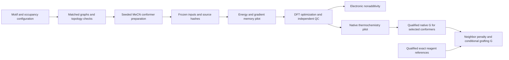

# Polymer occupancy and conditional grafting framework

The framework compares defined grafting patterns on the same finite, H-capped
polystyrene backbone. It evaluates electronic site nonadditivity and, after native
thermochemistry passes QC, the free energy of adding a motif with another motif
already present. It does not assign experimental occupancy probabilities.

The [current panel](../results/polymer_models/spacing_current.json) points to the
[exact structures and results](../results/polymer_models/campaigns/2026-10-21_spacing_cds_recovery/index.html).
Raw calculations remain under the campaign's `raw_root` on shared storage.

## Model definition

The input [configuration](../config/polymer_spacing_pilot.json) specifies the motif,
repeat count, reactive sites, occupied-site pairs, backbone tetrahedral tags,
sampling seeds, solvent, temperature, base and byproduct models. Sites are
one-based repeat-unit indices. Every repeat has two backbone carbon atoms;
an n-repeat model has 2n−1 backbone C–C bonds and two ends.

Each site is explicitly one of:

| Site state | Chemical model |
| --- | --- |
| Outside `reactive_sites` | Plain styrene, without a benzyl handle |
| Reactive and unoccupied | Para benzyl chloride |
| Reactive and occupied | Para benzyl group attached to the specified motif atom |

The initial method control uses five repeats, handles at 2/3/4 and plain-styrene
padding at 1/5. It compares pairs 2–3 and 2–4. Deduplicated matched controls are
`occ_none`, `occ_2`, `occ_3`, `occ_4`, `occ_2_3`, `occ_2_4`: six exact graphs,
with two selected xTB conformers each. The common backbone is mapped before
substitution, so stereochemistry is compared by mapped-neighbor orientation;
changing substituents can change CIP labels without changing that orientation.
All four terms of each cycle must balance atoms and charge.

Reactive-handle density and conversion of handles are distinct inputs. Neither
their chosen values nor a five-repeat model establishes actual polymer loading,
spacing, end-effect convergence, interchain packing or bead-scale behavior.

## Two scientific quantities

For sites i and j, let 00 denote both sites retaining chloride; i, j and ij denote
the corresponding grafted structures, with all other sites unchanged.

`ΔΔE = E(ij) + E(00) − E(i) − E(j)`

This relaxed electronic nonadditivity includes changes in backbone conformation,
motif contacts and continuum-solvent response. It is not a pure motif binding
energy. Selected structures are the lowest qualified electronic-energy conformers
among the sampled attempts; the selection is finalized only when those attempts
are terminal. Sampling failures stay visible.

Native solution DFT thermochemistry gives a separate quantity:

`ΔΔG = G(ij) + G(00) − G(i) − G(j)`

For neutral N–H/O–H substitution with base B and precursor HNu, the separated-ion
model has `K = G(BH+) + G(Cl−) − G(B) − G(HNu)`.
The contact-pair model instead uses `G(BHCl) − G(B) − G(HNu)` plus the explicit
1 M standard-state correction for Δn = −1 (−7.926 kJ/mol at 298.15 K).

`ΔG(j | empty) = G(j) − G(00) + K`

`ΔG(j | i occupied) = G(ij) − G(i) + K`

Their difference is ΔΔG; reagent terms cancel. Both grafting orders are reported.
A positive neighbor penalty makes the second graft less favorable, while its
absolute grafting ΔG may still be negative. Base choice changes absolute grafting
ΔG within these models. It does not change this matched neighbor penalty because
the polymer states here have no explicit base. Specific base–polymer interactions
would require additional states.

Native G is calculated for the selected conformer, not an equilibrated conformer
ensemble. Low frequencies and conformational sampling remain material limitations.
No validated synthesis-rejection threshold or electron-transfer rate follows from
these molecular quantities. The phthalimide panel is an explicitly scoped method
control, not synthesis admission.

## Pipeline and acceptance



| Responsibility | Implementation |
| --- | --- |
| Exact site chemistry, mapped backbone, balanced cycles | `src/redox/build/polymer_cases.py` |
| Reproducible conformer preparation and exact input manifests | `scripts/pipeline/prepare_polymer_spacing.py` |
| Frozen state, admission, numerical cycles and production adapters | `src/redox/workflows/polymer_campaign.py` |
| Resource gates, atomic claims, workers and bounded coordinator | `scripts/pipeline/run_polymer_spacing.py` |
| Exact molecular diagrams and field-specific pending values | `scripts/plotting/polymer_models/polymer_spacing_report.py` |

Warm starts use GFN2-xTB/ALPB acetonitrile. Production uses the existing
r2SCAN-D4/def2-SVP/SMD(MeCN) geometry and wB97M-V/def2-TZVPD/SMD electronic protocol.
Geometry optimization allows 400 steps with SCF tolerance 1e-11 and retains the
existing physical convergence gates. Native Hessians use the qualified solution
DFT/qRRHO/spin protocol at 298.15 K. The initial energy phase does not compute
Hessians; native thermochemistry is a separate stage with its own pilot.

Every GPU worker must pass node/runtime preflight and `gpu_reserve`, inherit its
own disjoint two-CPU allocation and capped native pools, and verify frozen hashes.
The large panel currently requires an 80 GiB class GPU; smaller devices are not
admitted without a separate resource qualification. Suitable available devices
are used up to the number of pending tasks. A resource pilot serializes only the
qualification dependency. Occupied devices remain unavailable.

Input manifests, seeds, attempts, owners, failed outputs and geometry trajectories
are retained. Optimizer evaluations are checkpoints, not qualified minima.
Completion requires output hashes, exact task identity, topology/stereo/clash
checks, independent stationarity and admitted SP records. Native G additionally
requires the exact native thermal definition and QC. Missing G or missing reagent
references remain null; electronic energies never fill thermochemical fields.

## Reproducing or extending a campaign

Use the validated NFS interpreter and cap native CPU threads before preparation:

```bash
export PYTHONPATH="$PWD/src"
export OMP_NUM_THREADS=1 OMP_THREAD_LIMIT=1 MKL_NUM_THREADS=1
export OPENBLAS_NUM_THREADS=1 NUMEXPR_NUM_THREADS=1 XTB_THREADS=1
REDOX_PY=/nfs/lambda_stor_01/homes/rzhu/miniforge3/envs/redox/bin/python
CAMPAIGN=results/polymer_models/campaigns/UNIQUE_RUN_NAME
"$REDOX_PY" scripts/pipeline/prepare_polymer_spacing.py --config config/polymer_spacing_pilot.json --out "$CAMPAIGN" --workers 4
"$REDOX_PY" scripts/pipeline/run_polymer_spacing.py freeze --campaign "$CAMPAIGN"
"$REDOX_PY" scripts/pipeline/run_polymer_spacing.py coordinate --campaign "$CAMPAIGN" --max-hours 48
```

Run the bounded coordinator in a detached session for unattended work. It saves
its host, PID and process-start identity. A later `coordinate --resume` refuses a
live or unverifiable owner and archives the prior coordinator record. It does
not clear failures, reclaim task claims by age or overwrite incomplete attempts.
Review failed attempts and their owners before defining a separate continuation.
Use `collect --campaign "$CAMPAIGN"` to recheck receipts and refresh the report
without submitting calculations. Reporting also refreshes as receipts arrive.

Change `motif_id` to a registered motif or replace it with an inline definition:

```json
"motif": {
  "id": "custom_phenol",
  "fragment": "[*:1]Oc1ccccc1",
  "precursor_smiles": "Oc1ccccc1"
}
```

The single mapped dummy specifies the new benzyl bond. The precursor, when
declared, must match the exact fragment. Registered N-linked phthalimide/PMDI/NDI
and O-linked BQ/AQ cases are covered by graph tests. The initial quantum backend
admits neutral singlets and N–H/O–H substitution only. Charged/quaternizing motifs
require a separately defined counterion, charge-state and resource model.

DBU and DIPEA are the qualified shared base references. For a new precursor,
`grafting.reagent_receipts` can supply a qualified completion receipt by role
(`precursor`, `base`, `protonated`, `chloride`, `pair`). Identity and native
temperature/solvent checks still apply. Without a qualified precursor receipt,
relative polymer ΔΔG can be evaluated, while absolute conditional grafting ΔG
stays pending. These overrides do not launch a missing reagent campaign.

Create a new campaign for any change to motif, configuration or numerical code.
The first panel preserves its original preparation code in `source_snapshot/`
and separately hashes the final quantum producers. Source immutability is checked
before computation and when outputs are admitted. Bulk xTB and quantum files stay
on NFS; small exact inputs, manifests, source snapshots and reports are versioned.

Targeted validation:

```bash
"$REDOX_PY" -m pytest -q tests/test_polymer_cases.py tests/test_polymer_campaign.py tests/test_polymer_campaign_admission.py tests/test_oligomer_topology.py
```

## Checked native-thermal checkpoint

The [independent review](../results/reviews/2026-10-22/spacing_native_complete/summary.json)
checks all twelve electronic conformers and all six selected native free energies.
The [figure and data](../results/figures/polymer_models/conditional_grafting.pdf)
report ΔΔG = −5.15 kJ/mol (adjacent) and −11.23 kJ/mol (one spacer).
Their rotor-cutoff ranges are −5.15 to −4.66 and −12.14 to −11.23 kJ/mol; these
are sensitivity ranges, not statistical intervals. The full selected conformer
cycles balance atoms/charge and agree with conditional DBU grafting differences.
These phthalimide controls establish the implemented workflow for the stated
scenarios. The original oligomer panel and broader redox-core, conformation and
end-effect sensitivity still require review before general design conclusions.
