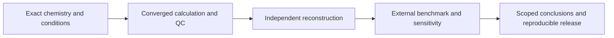

# Publication readiness

The intended contribution is a reproducible computational framework for selecting
redox motifs for grafting onto a preformed polymer. It must connect exact molecular
identity, attachment chemistry and a defined local polymer environment, with
evidence appropriate to each claim. Publication readiness is not yet established.

## Requirements and completion evidence

| Requirement | Evidence required before closing it |
| --- | --- |
| Software correctness | Fresh regression results, explicit environment/dependency coverage, independent arithmetic and negative tests for changed/missing evidence |
| Restart and execution correctness | A real interrupted/resumed small-system comparison; unchanged scientific settings; preserved geometry and source ownership; numerical replays of memory adaptations |
| Experimental redox accuracy | A fixed endpoint panel with source conditions, exact identities, both wave-specific and family-specific residuals, coverage of missing/QC-rejected cases, and no outlier removal |
| Defined grafting thermodynamics | Balanced exact precursor/product routes; base, byproducts, solvent, temperature and standard state; representative method/conformer sensitivity; kinetics and yield claims kept separate |
| Polymer interaction analysis | Verified open-chain geometry; independent cycle arithmetic; qualified selected-geometry free energies; separation of segment interaction, deformation and electronic coupling; motif and spacing sensitivity |
| Decision reliability | Identify conclusions that survive conformer, numerical, method and environment sensitivity; leave smaller differences unresolved rather than treating them as robust rankings |
| Reproducible release | Reproduction commands, source/input/output hashes, environment records, accessible small examples, and figures regenerated from the same admitted data |
| High-throughput parallelization | Streaming inputs, exact deduplication, chunked distributed scheduling, bounded memory/file counts, measured throughput and verified interruption/recovery on molecular inputs |
| Repository consolidation | Finish and review the four scientific tasks first, then perform the requested figure/script organization and archival with resolvable historical provenance |

An observed prediction error is a result, including a large error. It does not
automatically fail an entire computational paper. It does constrain which
families, properties and selection decisions the paper can support. A numerical
check passing does not establish experimental accuracy.

The [high-throughput execution contract](HIGH_THROUGHPUT.md) records the user's
million-molecule requirement. Existing small-campaign parallelism is not a scale
qualification; stage-specific throughput and recovery need separate measurements.



## Frozen retrospective benchmark

The [frozen panel](../results/validation/publication_benchmark/panel_v1.json)
contains every currently sourced strict endpoint: 39 potentials across 30 exact
free-parent molecules. The source catalog retains lower-tier and excluded values
and their reasons. The panel is retrospective; it is not a held-out validation set.
Its contents are fixed before completing the additional calculations. New sources
require a new panel version rather than silently changing this denominator.

The latest independent review admits 38/39 potentials from 30 parents and seven
original studies. All 22 native-completion molecule jobs are terminal; one
endpoint still requires its source-addressed alternate-spin check. Its first attempt ran out of GPU memory after the optimizer converged. The [checkpoint continuation](../results/validation/publication_benchmark/spin_resume_2026-10-22/plan.json) preserves that geometry and requires a larger-memory device; the physical gates and active energy protocol remain unchanged. The
[current analysis](../results/validation/publication_benchmark/current.json) uses
unrounded values and reports event-weighted errors, molecule-weighted MAE,
family/wave coverage, signed two-wave spacings and all outliers. Study and molecule
clusters are reported separately; intervals are left blank with fewer than five
clusters. These are resampling summaries of this panel, not prediction intervals
for new molecules. The source conditions can differ from the bare-ion continuum
model, and are documented in the [experimental data guide](../data/raw/validation/two_wave_mecn/README.md).

Do not fit an offset and report its training residuals as validation. Future
method tuning requires a separate declared calibration set and a genuinely
untouched molecule/study test set. Exact-graft and polymer accuracy cannot be
inherited from measured free-parent potentials.

Regenerate an independent review into a new directory, selecting all parent IDs
in the panel with `scripts/validation/benchmark/review_matched_parents.py`.
Then audit its inputs and publish the descriptive report:

```bash
PYTHONPATH=src python scripts/validation/benchmark/publication_benchmark.py report \
  --panel results/validation/publication_benchmark/panel_v1.json \
  --review results/reviews/NEW_INDEPENDENT_REVIEW \
  --out results/validation/publication_benchmark/current.json
```

The consumer refuses changed sources, altered experimental labels, duplicate
endpoints, unqualified calculated values, mismatched unrounded energies and
failed independent checks. A derived report remains a dated snapshot; revalidate
it before manuscript use because active calculations can change its backing inputs.

## Calculation completion and current limits

The [native completion plan](../results/validation/publication_benchmark/native_completion_2026-10-21/plan.json)
prepares 48 missing native states in 22 molecule jobs, using existing checked
geometries and active energies. The separately held BQ record was already qualified but unselected; its thermal
policy was restored without a Hessian rerun. This is a benchmark method-control campaign, not synthesis
eligibility. Completed thermal surfaces remain separate from spin admission and
experimental agreement. Failed attempts retain their outputs and require review;
no retry deletes an invalid addressed cache.

The supported source-preserving launch entry point for this frozen campaign is
`scripts/pipeline/launch_native_benchmark.py --campaign PATH`. It corrects an SSH
detachment issue without changing the numerical producers used by live workers.
After the campaign closes, incorporate that correction into the reusable launcher
and remove the temporary adapter through the planned cleanup. Fresh starts must
still use the system reservation gate, node preflight, disjoint CPU allocations
and all suitable free GPUs that the remaining workload can use.

The [polymer validation](../results/polymer_models/workflow_validation.json)
has 12 electronic conformers and all six selected native free energies. Two
independent neighboring-site/conditional-grafting cycles now close; the original
oligomer panel is 26/27 checked structures.
The recovered unoccupied alternative changes the selected conformer; it therefore
requires its own Hessian instead of borrowing the other geometry's thermal term.
The phthalimide spacing panel is a method control. Broad redox-motif/polymer
design rules still need representative redox cores and conformational sensitivity.

The [numerical replay checkpoint](../results/reviews/2026-10-21/polymer_numerical_repairs/README.md)
documents the bounded-memory Hessian and single-point controls. These establish
execution equivalence within the stated models. They do not supply an independent
high-level benchmark of grafting free energies or motif interaction strength.

## Before manuscript submission

Close the ongoing polymer calculations and inspect actual physical QC. Complete
or explicitly resolve the benchmark panel, then run representative grafting and
interaction method/sampling controls. Rebuild the candidate tables and figures
from one admitted source snapshot, with methods and claim limits derived from
those exact artifacts. Perform the requested repository consolidation only after
the four scientific tasks have been reviewed. Experimental graft loading,
swelling, transport, yield and cycling performance remain future measurements.
