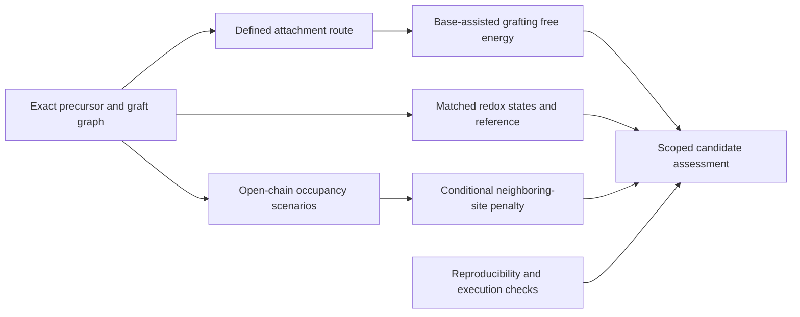

# Working manuscript outline

Provisional title: **A route-aware computational framework for redox motif selection on preformed polymers**.
This is a methods-focused in silico paper. The evidence snapshot is
[22 October 2026](evidence/2026-10-22/manifest.json); incomplete physical analyses
remain explicit. Authorship, venue and submission timing are undecided.

The central question is how to combine exact molecular identity, defined-condition
attachment thermodynamics and conditional neighboring-site effects without
conflating those quantities with experimental synthesis or whole-bead behavior.

| Section | Argument and evidence | Remaining work |
| --- | --- | --- |
| Introduction | Preformed functionalized beads provide a relevant experimental architecture; computational selection must connect molecular redox properties to attachment and local environment | Expand targeted context and novelty comparison |
| Methods | Exact precursor/product pairs; field-specific QC; matched Fc reference; base/byproduct and standard-state bookkeeping; open-chain occupancy controls; chunked scheduling and provenance | Complete release example and selected quantum restart equivalence |
| Results: expansion and calibration | 1,593 recipes / 837 exact designs, distinct from the historical 75-candidate evaluation; 38/39 benchmark potentials from 30 molecules, seven studies | Last endpoint and NDI-specific external anchor |
| Results: grafting | Two BQ HCl-reference reactions change sign under modeled DBU/DIPEA conditions; five candidates / 20 base-assisted values, one held candidate | Representative method/conformer sensitivity and exact-route review |
| Results: polymer | Exact open backbone, dense and partial occupancy scenarios; interaction/deformation separation; selected reference conformer changes electronic nonadditivity | All six native free energies and both conditional cycles checked; one trimer slot and representative redox-core sensitivity remain |
| Results: execution | Million-task scheduling control, 837 real descriptor comparisons, real shared-filesystem crash/restart with 17 molecular tasks | Controlled concurrency curves and selected conformer/quantum adapters |
| Discussion | Different selection dimensions, limits of transfer from free parents, conformer and ion-pair uncertainty, distinction between association and charge transport | Reassess decisions after pending physical checks |

Primary context is Kim et al., *Chemistry—A European Journal* (2022),
[10.1002/chem.202200149](https://doi.org/10.1002/chem.202200149).
Methods references cover SMD, r2SCAN, D4, omegaB97M-V, the def2 basis family,
PySCF/GPU4PySCF, GFN2-xTB and ALPB. The paper will not describe the retrospective
benchmark as held out, the scheduler timing as quantum throughput, or neutral
association energies as electron-transfer rates.
